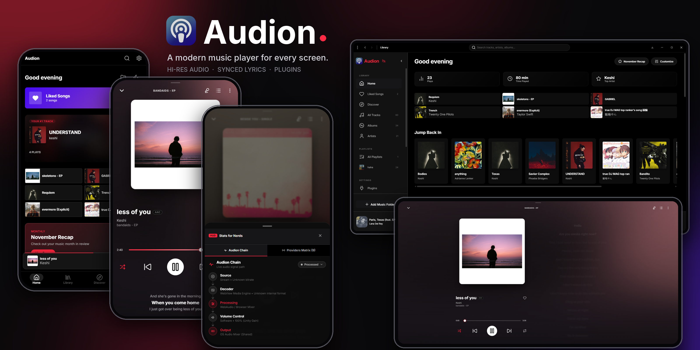
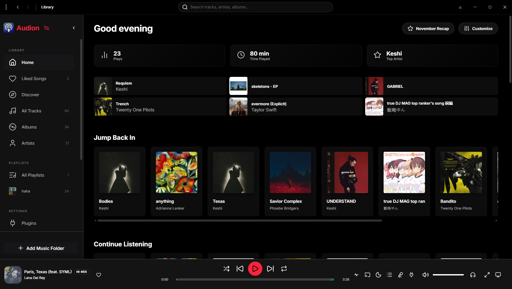
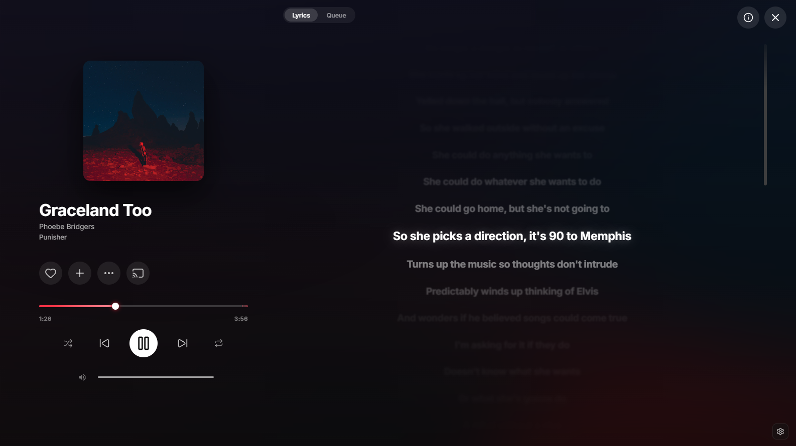
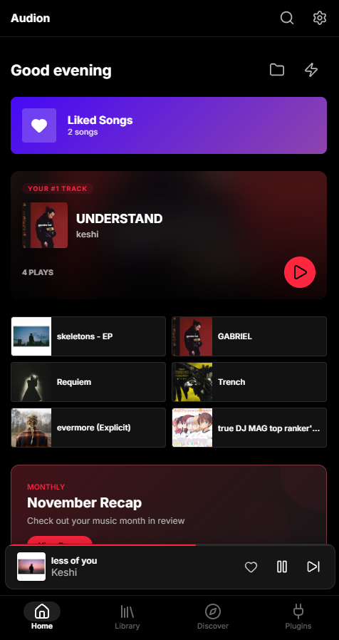
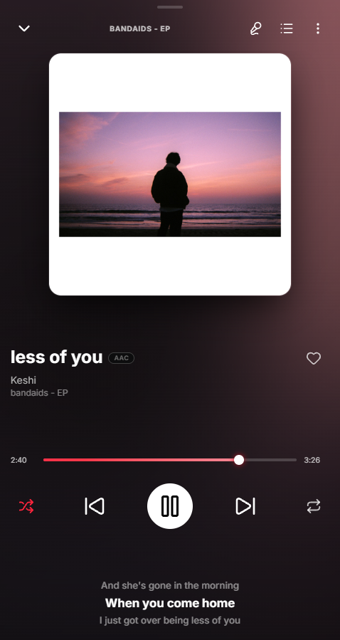
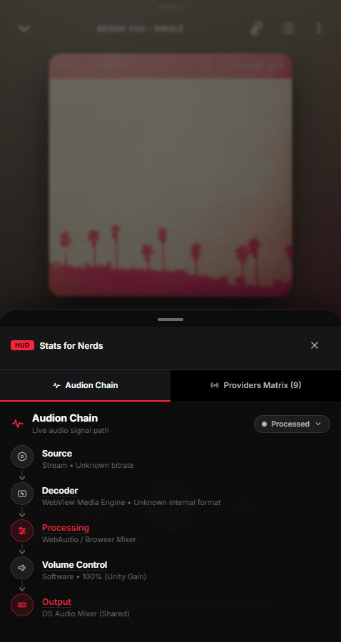
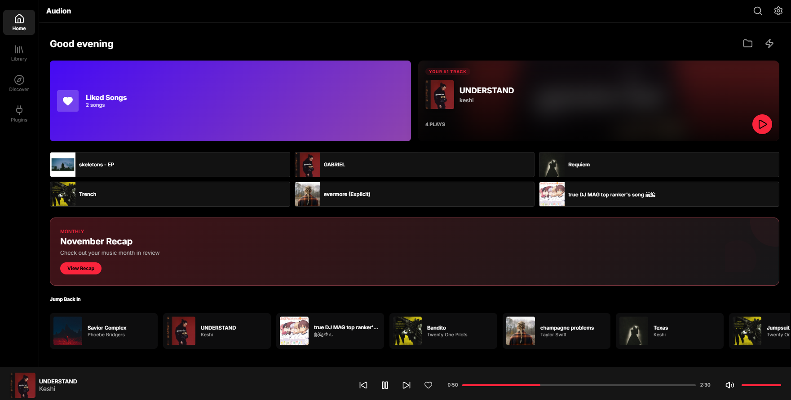
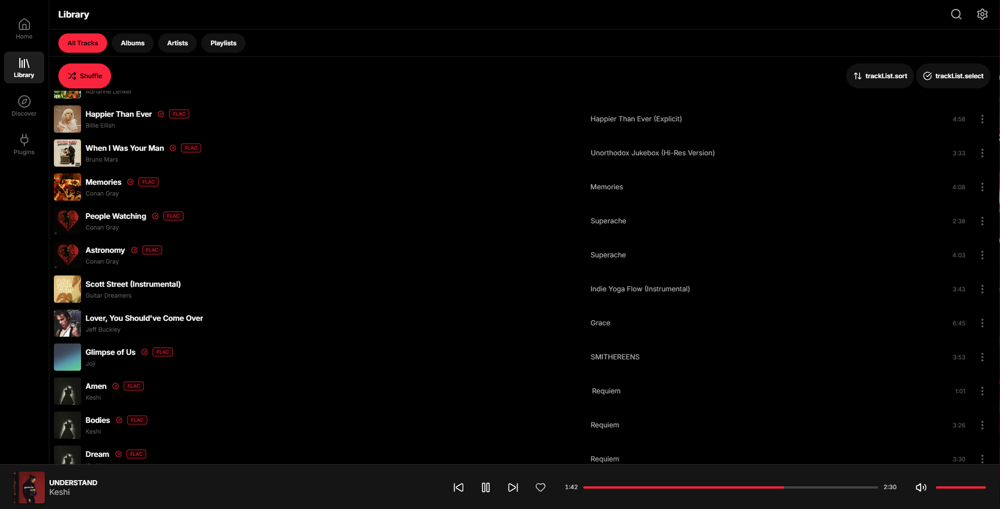
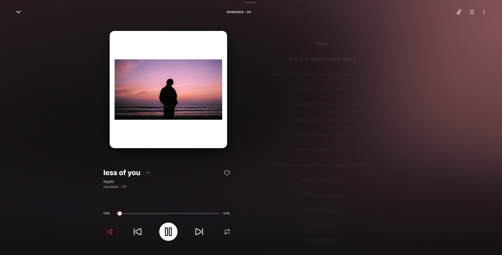

<div align="center">



<p>
  <strong>A local-first music player for your own library</strong>
</p>

<p>
  <a href="https://github.com/dupitydumb/Audion/releases/latest"></a>
  <a href="https://github.com/dupitydumb/Audion/releases"></a>
  <a href="https://github.com/dupitydumb/Audion/stargazers"></a>
  <a href="https://github.com/dupitydumb/Audion/blob/master/LICENSE"></a>
  <a href="https://aur.archlinux.org/packages/audion-bin"></a>
  <a href="https://discord.gg/27XRVQsBd9"></a>
</p>

<p>
  <a href="https://fmhy.net/audio#audio-players" target="_blank" rel="noopener noreferrer"></a>
</p>

<p>
  
  
  
  
</p>

<p>
  <a href="#-screenshots"><b>Screenshots</b></a> &nbsp;·&nbsp;
  <a href="#-features"><b>Features</b></a> &nbsp;·&nbsp;
  <a href="#-download"><b>Download</b></a> &nbsp;·&nbsp;
  <a href="#-self-hosted-server-docker"><b>Self-Hosted Server</b></a> &nbsp;·&nbsp;
  <a href="#%EF%B8%8F-build-from-source"><b>Build from Source</b></a> &nbsp;·&nbsp;
  <a href="#-faq"><b>FAQ</b></a> &nbsp;·&nbsp;
  <a href="#-support"><b>Support</b></a>
</p>

</div>

Audion is a desktop, mobile, and TV player for the music you already own. Index your folders once, then get synced lyrics, AutoMix crossfading, custom skins, plugins, and self-hosted streaming — all without an account, tracking, or a permanent internet connection.

---

## 📸 Screenshots

<div align="center">

### Desktop

<table>
  <tr>
    <td width="50%">
      <a href="promotional/Main_Desktop.png">
        
      </a>
    </td>
    <td width="50%">
      <a href="promotional/Fullscreen_Desktop.png">
        
      </a>
    </td>
  </tr>
</table>

### Mobile (Android)

<table>
  <tr>
    <td width="33%">
      <a href="promotional/Main_Android.png">
        
      </a>
    </td>
    <td width="33%">
      <a href="promotional/Fullscreen_Android.png">
        
      </a>
    </td>
    <td width="33%">
      <a href="promotional/Stats_Android.png">
        
      </a>
    </td>
  </tr>
</table>

### Tablet & TV

<table>
  <tr>
    <td width="33%">
      <a href="promotional/Main_TV_Tablet.png">
        
      </a>
    </td>
    <td width="33%">
      <a href="promotional/Library_TV_Tablet.png">
        
      </a>
    </td>
    <td width="33%">
      <a href="promotional/Fullscreen_TV_Tablet.png">
        
      </a>
    </td>
  </tr>
</table>

<p><em>Click any screenshot to view full size</em></p>

</div>

---

## ✨ Features

<table>
  <tr>
    <td width="50%" valign="top">
      <p><b>Playback & Output</b></p>
      <p>
        Rock-solid playback for FLAC, MP3, AAC, ALAC, Opus, and more. Includes
        exclusive DAC output on Windows (WASAPI) and Linux (ALSA) for bit-perfect
        audio, AutoMix crossfading, live codec/bit-depth/sample-rate telemetry in
        Stats for Nerds, persistent queues, and Android Auto support.
      </p>
    </td>
    <td width="50%" valign="top">
      <p><b>Library & Organization</b></p>
      <p>
        Automatic library scanning with metadata extraction and incremental
        rescans. Organize with smart playlists, duplicate detection and merging,
        folder- and format-aware browsing, and virtualized tracklists built for
        large collections on desktop and mobile.
      </p>
    </td>
  </tr>
  <tr>
    <td width="50%" valign="top">
      <p><b>Lyrics</b></p>
      <p>
        Synced lyrics from LRCLIB with karaoke-style word highlighting in
        fullscreen mode and lyric cards. Loaded lyrics are cached offline
        automatically, and you can export or share lyric cards from both desktop
        and mobile.
      </p>
    </td>
    <td width="50%" valign="top">
      <p><b>Customization & Skins</b></p>
      <p>
        Light, dark, or system-matched themes with custom accent colors and
        artwork-driven theming. Includes Skin Studio for built-in and local
        skins, an Island mini-player, keyboard shortcuts, and responsive layouts
        for desktop, mobile, tablet, and TV.
      </p>
    </td>
  </tr>
  <tr>
    <td width="50%" valign="top">
      <p><b>Plugins & Providers</b></p>
      <p>
        JavaScript/WASM plugin system with a built-in marketplace
        (<a href="./PLUGINS.md">learn more</a>). Manage stream, metadata, and
        lyrics providers in Settings with priority ordering, per-provider
        toggles, and cross-provider handoff.
      </p>
    </td>
    <td width="50%" valign="top">
      <p><b>Everywhere & Private</b></p>
      <p>
        Available on Windows, macOS, Linux (AppImage, Flatpak, AUR), and
        Android (per-ABI and universal APKs). Supports self-hosted Docker
        streaming, Last.fm and ListenBrainz scrobbling with an offline queue,
        and localization in English, Russian, French, and Spanish.
      </p>
    </td>
  </tr>
</table>

---

## ⚡ Download

Get the latest builds from [Releases](https://github.com/dupitydumb/Audion/releases/latest).

| Platform | Asset |
| --- | --- |
| Windows | `Audion_x64-setup.exe` |
| macOS | `Audion.dmg` |
| Linux (AppImage) | `Audion-x86_64.AppImage` |
| Linux (Flatpak) | `audion_<version>_linux.flatpak` |
| Arch Linux (AUR, community maintained) | `yay -S audion-bin` |
| Android | `Audion.apk` (per-ABI builds and universal APK also published) |

### First Run

1. Launch Audion
2. Click **Add Music Folder** and select your music directory
3. Wait for the scan to complete
4. Press play

### Arch Linux / Arch-based Distros

```bash
# Using yay
yay -S audion-bin

# Using paru
paru -S audion-bin
```

### Linux Troubleshooting & Flags

Audion uses GPU hardware acceleration on Linux by default. If you encounter driver crashes, blank windows, or run inside a VM:

```bash
AUDION_SAFE_MODE=1 audion            # force software rendering
AUDION_SOFTWARE_RENDERING=1 audion   # same, explicit flag
AUDION_DISABLE_SANDBOX=1 audion      # for restricted container environments
```

Virtual machines (VirtualBox, VMware, QEMU) and Flatpak/AppImage sandbox restrictions are detected automatically.

### Android Notes

Install builds only from the official Releases page, and enable "Install unknown apps" for whichever app you download the APK with. Individual per-ABI APKs (`arm64-v8a`, `armeabi-v7a`, `x86`, `x86_64`) are smaller; use the `universal` APK if you are unsure of your device architecture.

---

## 🐳 Self-Hosted Server (Docker)

Audion supports a self-hosted streaming server (`audion-server-docker`) written in Rust with a responsive Svelte frontend, so you can host your library on a home server or VPS and stream to Audion clients from anywhere.

### Running Audion Server

A preconfigured `docker-compose.yml` is available in the `audion-server-docker` directory:

1. **Verify configuration** in `audion-server-docker/docker-compose.yml`:
   ```yaml
   services:
     audion-server:
       build:
         context: .
         dockerfile: Dockerfile
       ports:
         - "8080:8080"
       volumes:
         - ./data:/data
       environment:
         - AUDION_ADMIN_USER=admin
         - AUDION_ADMIN_PASSWORD=securepasswordhere # Change this!
         - AUDION_JWT_SECRET=your-secret-key-here
         - AUDION_DATA_DIR=/data
   ```

2. **Start the server**:
   ```bash
   cd audion-server-docker
   docker compose up --build -d
   ```

3. **Access the web interface** at `http://localhost` to manage files, playlists, and users.

### Connecting the Client

1. Open Audion settings.
2. Under **Server Connection**, select **Custom Server**.
3. Enter your server URL (e.g. `http://your-server-ip:8080`) and credentials.
4. Stream your library, sync it, and control it remotely.

---

## 🛠️ Build from Source

**Requirements:** Node.js 18+, Rust (latest), Tauri CLI

```bash
git clone https://github.com/dupitydumb/Audion.git
cd Audion
npm install
npm run tauri dev    # development
npm run tauri build  # production build
```

**Tech stack:** Tauri 2.0, SvelteKit, Rust, SQLite

---

## 🤖 Agent Skills

Audion has a companion repo of agent skills for AI coding assistants. Each skill is a `SKILL.md` in the open Agent Skills format, with the steps, skeletons, and permission rules the runtime actually enforces, so an agent does not have to reverse-engineer the source to build something that loads.

```bash
npx skills add dupitydumb/Audion-Skills
```

| Skill | What it covers |
| --- | --- |
| `audion-plugin` | `plugin.json`, lifecycle hooks, permission-gated API, events, providers, UI slots |
| `audion-skin` | `.audionskin` packages, folder skins, color tokens, custom CSS, canvas effects |
| `audion-registry` | Publishing to the community marketplace, and what the installer actually downloads |

Install a single skill with `npx skills add dupitydumb/Audion-Skills --skill audion-skin`. Sources and full reference pages: [dupitydumb/Audion-Skills](https://github.com/dupitydumb/Audion-Skills).

---

## ❓ FAQ

<details>
<summary><b>Is Audion free?</b></summary>
<br>

Yes — free and open source under GPLv3. Donations are voluntary.

</details>

<details>
<summary><b>Does it need an internet connection?</b></summary>
<br>

No. Playback, lyrics caching, and library management work fully offline. Network access is only needed for optional features such as online lyric sources, scrobbling, provider streaming, and updates.

</details>

<details>
<summary><b>Where is my music stored?</b></summary>
<br>

Wherever it already lives. Audion indexes your folders in place and never moves or re-encodes your files.

</details>

<details>
<summary><b>Does it phone home?</b></summary>
<br>

No telemetry or tracking. Cloud sync and scrobbling are opt-in.

</details>

<details>
<summary><b>How do I request a feature or report a bug?</b></summary>
<br>

Open an [issue](https://github.com/dupitydumb/Audion/issues) or join the [Discord](https://discord.gg/27XRVQsBd9).

</details>

---

## 🤝 Contributing

Contributions are welcome — translations, bug reports, plugins, and code.

- [Issues](https://github.com/dupitydumb/Audion/issues) — bugs and feature requests
- [PLUGINS.md](./PLUGINS.md) — build plugins
- [Audion-Skills](https://github.com/dupitydumb/Audion-Skills) — agent skills for building plugins and skins
- [developerguide.md](./developerguide.md) — architecture and development setup
- [Discord](https://discord.gg/27XRVQsBd9) — discuss ideas

---

## 💙 Support

> [!NOTE]
> Audion is free and stays free. Support pays for hosting, development time, and code-signing certificates — nothing else.
>
> <p>
>   <a href="https://ko-fi.com/N4N5UMNR1"></a>
>   <a href="https://www.patreon.com/AudionPlayer"></a>
> </p>

---

## 📄 License

Licensed under the **GNU General Public License v3.0 or later** (GPL-3.0-or-later). See [LICENSE](./LICENSE).

Audion is an independent project: it hosts no media and is not affiliated with any streaming service it may integrate with through plugins.

> [!TIP]
> **Star the repo** to get notified about all new releases directly from GitHub.

<p align="center">
  Built with <a href="https://tauri.app">Tauri</a> and <a href="https://svelte.dev">Svelte</a>
</p>
